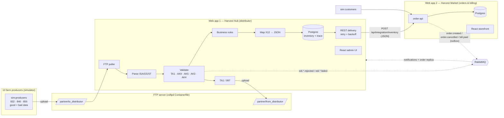

# EDI Simulator — learn ANSI X12 by running a B2B supply chain

A self-contained, Docker-based playground for learning **EDI (ANSI X12 004010)**. Ten farm **producers** send X12 documents over **FTP** to a **distributor**. The distributor validates, acknowledges (TA1 / 997), maps them to JSON, ingests them into its inventory, and pushes them over **REST** to an **order & billing** app where customers buy the products. Every step is traceable back to the original X12 envelope, and **RabbitMQ** carries the notifications and events.



## Quick start

Requirements: Docker (Desktop) with Compose v2. Node 22+ is only needed to run the simulator from your host.

```bash
npm install                     # once, for the simulator / local dev
docker compose up -d --build    # postgres, rabbitmq, ftp, 2 APIs, 2 web apps

# 1) producers: one valid 832 catalog per producer, then 40 mixed transactions (25% bad)
npm run sim:producers -- --bootstrap -n 40 -b 0.25

# 2) customers: browse the EDI-loaded inventory, order, cancel, pay
npm run sim:customers -- -c 5 -o 20
```

No Node on the host? Run the simulator as a container instead:

```bash
docker compose run --rm simulator producers --bootstrap -n 40
docker compose run --rm simulator customers -o 20
```

| What | URL | Login |
|---|---|---|
| **Distributor** (EDI control center) | http://localhost:3000 | `admin@harvesthub.local` / `admin123` |
| **Order app** (customer storefront) | http://localhost:3001 | `alice@freshbistro.local` / `password123` (8 seeded customers, or register) |
| RabbitMQ management | http://localhost:15672 | `edi` / `edi` |
| Distributor API / Prometheus metrics | http://localhost:4000/api/health · /metrics | |
| Order API | http://localhost:4100/api/health | |
| FTP | `ftp://localhost:21` | `distributor`/`distributor123`, producers e.g. `greenvalley`/`producer123` |
| Prometheus (optional) | http://localhost:9090 | `docker compose --profile observability up -d` |

Reset everything (databases, FTP mailboxes, queues): `docker compose down -v`.

## The scenario

| Role | Who | What they do |
|---|---|---|
| **Producers** (senders) | 10 farms: Green Valley Farms, Sunrise Orchards, Meadow Creek Dairy, … each with an ISA ID such as `GREENVALLEY` | Send X12 over FTP. Together they offer **100 farm products** (10 each) with real UPC-A check digits ([packages/shared/src/catalog.ts](packages/shared/src/catalog.ts)) |
| **Distributor** (receiver) | Harvest Hub Distribution, ISA ID `HARVESTHUB` | Receives, validates, acknowledges, maps, stores, and forwards inventory to the order app. Admins see everything |
| **Customers** | Restaurants and grocers in the order app | Buy what's in stock. Every order creates a **bill due in 30 days (Net 30)** and notifies the distributor |

### Transaction sets

| Set | GS01 | Name | Effect in the distributor |
|---|---|---|---|
| **832** | SC | Price/Sales Catalog | Creates/updates products, unit cost and price (sell price = cost + 35% markup) |
| **846** | IB | Inventory Inquiry/Advice | Sets the quantity available for sale (`QTY*33`) |
| **856** | SH | Ship Notice (ASN) | Hierarchical `HL` Shipment → Order → Item; adds the shipped quantity to stock |
| **997** | FA | Functional Acknowledgment | *Sent back* to the producer: accepted/rejected per group (AK9), per transaction (AK5), per segment (AK3) and per element (AK4) |
| **TA1** | — | Interchange Acknowledgment | *Sent back* when the envelope is rejected or when `ISA14 = 1` |

## What happens to one file

1. **Transfer.** The producer uploads `846_GREENVALLEY_000000123.x12.tmp` and renames it to `.x12`, so the distributor never reads a half-written file. The FTP poller (every 5 s) downloads it, stores its SHA-256, and moves it to `archive/`. Download failures are retried up to 5 times, then the file is moved to `error/`.
2. **Parse.** The delimiters are read from the fixed-length ISA: the element separator is ISA character 4, ISA16 is the component separator, and the next character is the segment terminator. The file is then split into the envelope tree ISA → GS → ST…SE → GE → IEA.
3. **Envelope validation (TA1).** Checks ISA length (106), element values, receiver = `HARVESTHUB`, sender = the mailbox owner, IEA02 = ISA13, IEA01 = group count, and duplicate control numbers.
4. **Group validation (997 AK9).** Checks GS01 is supported, version is `004010`, GE02 = GS06 and GE01 = transaction count.
5. **Transaction validation (997 AK5/AK3/AK4).** Checks SE01 segment count, SE02 = ST02, and segment order, usage and loops against the transaction spec. Element type, length, code list, date and time are checked too, plus guide rules (CTT count, HL parent references).
6. **Business rules.** These run on syntactically valid sets: valid UPC check digit, product exists (send an 832 first), product belongs to this producer, positive price and quantity, ship-to is the distributor. A failure here still gets **997 = Accepted**, because syntax ≠ business, but the transaction is `BUSINESS_REJECTED`.
7. **Map → JSON.** Two views are kept. The *X12 JSON* is a structure-preserving view like the course slide (`transactionSetHeader`, `beginningSegmentFor…`). The *normalized JSON* holds business objects.
8. **Ingest.** Products and quantities are updated, with an inventory movement that links each change to the transaction.
9. **Deliver.** The data goes to the order app as `POST /api/integration/inventory` (idempotent on `transactionId`). Retries use exponential backoff: 2 s, 4 s, 8 s, 16 s, then `DEAD` plus a notification. `DELIVERY_FAILURE_RATE` (default 5%) injects transient failures so you can watch retries. You can also stop the order app with `docker compose stop order-api`.
10. **Acknowledge.** The TA1 and/or 997 interchange is uploaded to `from_distributor/`. Producers can fetch them with `npm run sim:acks`.
11. **Notify.** Events are published to RabbitMQ (`edi.events`). Rejections and failures are routed to `distributor.notifications` and appear in the UI bell.

Every step is written to the **processing timeline**. In the distributor UI, open any envelope, transaction or product and follow the chain *product → inventory movement → transaction set → interchange → FTP file*.

## Simulating

### Producers (X12 over FTP)

```bash
npm run sim:producers -- [options]
  -n, --count 20          transactions to send
  -b, --bad-ratio 0.25    share with injected errors
  -t, --types 832,846,856
  -p, --producers 3       N random producers, or a list: GREENVALLEY,HAPPYHEN
  -i, --interval 300      ms between files
      --bootstrap         first send a valid 832 from each producer (do this on a fresh DB)
  -s, --scenario ID       force one error scenario for every file
      --dry-run           only write files to ./simulator-output/sent
npm run sim:scenarios     # list all bad-data scenarios
npm run sim:acks          # download the TA1/997 the distributor sent back
npm run sim:inspect -- simulator-output/sent/<file>.x12   # explain a file segment by segment
```

Every file is also saved in `simulator-output/sent/`, with a `manifest.jsonl` recording which scenario was injected and the expected acknowledgment.

### Bad-data scenarios

| Layer | Scenarios | Detected as |
|---|---|---|
| Interchange | `ISA_IEA_CONTROL_MISMATCH`, `ISA_BAD_PADDING`, `UNKNOWN_SENDER`, `WRONG_RECEIVER`, `IEA_GROUP_COUNT`, `INVALID_ISA_DATE`, `DUPLICATE_INTERCHANGE`, `MISSING_IEA` | TA1 R (001, 022, 006, 009, 021, 014, 025, 023) |
| Functional group | `GS_GE_CONTROL_MISMATCH`, `GE_TRANSACTION_COUNT`, `UNSUPPORTED_VERSION`, `WRONG_FUNCTIONAL_ID` | 997 AK9 R (4, 5, 2) / AK5 6 |
| Transaction set | `SE_SEGMENT_COUNT`, `ST_SE_CONTROL_MISMATCH`, `MISSING_SE` | 997 AK5 R (4, 3, 2) |
| Segment | `MISSING_BEGINNING_SEGMENT`, `UNKNOWN_SEGMENT`, `MISSING_CTT` | 997 AK3 (3, 1) |
| Element | `INVALID_QUALIFIER`, `INVALID_DATE`, `NON_NUMERIC_QUANTITY`, `MISSING_REQUIRED_ELEMENT`, `ELEMENT_TOO_LONG`, `CTT_COUNT_MISMATCH`, `HL_INVALID_PARENT` | 997 AK4 (7, 8, 6, 1, 5) |
| Business | `UNKNOWN_PRODUCT`, `FOREIGN_PRODUCT`, `NEGATIVE_PRICE`, `NEGATIVE_QUANTITY` | 997 A, then business-rejected |

`npm test` runs every scenario through the validator and asserts the expected code ([apps/simulator/src/scenarios.test.ts](apps/simulator/src/scenarios.test.ts)).

### Customers (REST against the order app)

```bash
npm run sim:customers -- -c 5 -o 20 --cancel-ratio 0.15 --pay-ratio 0.3
```

Each action is written to a **transactional outbox** in the same DB transaction, then published to RabbitMQ `order.events`. The distributor consumes these events to keep a replica of customers, orders and bills, adjust stock, and raise notifications.

## The two web apps

**Distributor — Harvest Hub EDI Control Center** (admin)
- Dashboard with live KPIs, throughput charts, top validation errors, recent envelopes and notifications.
- **EDI**: interchanges with a full trace page (envelope visualization ISA→GS→ST, annotated segments, raw X12, validation issues with TA1/AK codes, processing timeline, acks, REST deliveries), transaction sets (X12 ⇄ X12-JSON ⇄ normalized JSON ⇄ payload sent to the order API, plus a redeliver button), FTP transfers (inbound/outbound, retries), the validation explorer, the delivery queue and acknowledgments.
- Notification center (EDI failures from RabbitMQ, order events).
- Producers (partner scorecards, FTP mailboxes, products) and inventory (stock, cost, price, movement history traced back to X12).
- Customers, orders and bills (Net 30, overdue), plus reports (revenue, AR aging, by category/producer, top customers/products).
- KPIs/observability page, an **X12 Inspector** (paste any X12 to see it explained and validated) and an **X12 reference** (segments, elements, code lists).

**Order app — Harvest Market** (customers): dashboard, shop (inventory synced from EDI, showing source ICN), cart and checkout, orders (cancel), bills (pay), and reports.

## KPIs

| KPI | Definition |
|---|---|
| Acceptance rate | transaction sets ingested ÷ received |
| First-pass yield | interchanges fully accepted ÷ received |
| Processing latency (avg / p95) | file downloaded → interchange processed |
| End-to-end latency | file received → JSON delivered to the order app |
| Ack turnaround | file received → TA1/997 uploaded to the partner |
| Delivery success / first-attempt success / retries / backlog / dead | REST integration health |
| Validation errors by level and code | where the partners' data quality problems are |
| Partner scorecard | acceptance rate, errors and last-seen per producer |
| Inventory | SKUs, units, stock value (cost/retail), low-stock, out-of-stock |
| Orders and billing | orders, revenue, AOV, cancellation rate, open AR, overdue AR |

Prometheus metrics (`edi_files_received_total`, `edi_transactions_total{type,status}`, `edi_validation_errors_total{level,code}`, `edi_processing_duration_seconds`, `edi_delivery_attempts_total`, `edi_acks_sent_total`, `mq_messages_*`) are exposed at `:4000/metrics`.

## Project layout

```
packages/
  x12/        X12 engine: parser, spec-driven validator, writer, 997/TA1 builders, mappers, inspector
  shared/     producers & 100 products, service contracts, RabbitMQ helper (topology)
  ui/         shared shadcn/ui components + theme (Tailwind v4)
apps/
  distributor-api/   Fastify + Prisma: FTP poller, pipeline, REST delivery, MQ consumers, KPIs
  distributor-web/   React admin console
  order-api/         Fastify + Prisma: customers, products, orders, bills, outbox, integration endpoint
  order-web/         React storefront
  simulator/         CLI: producers (X12 over FTP), customers (REST), inspect, acks
infra/
  ftp/Containerfile  vsftpd with one mailbox per partner
  docker/Dockerfile  multi-target image (api / web / simulator)
docs/X12-PRIMER.md   how to read an X12 envelope, using this project's files
```

## Local development (hot reload)

```bash
npm install
npm run infra:up                                   # postgres, rabbitmq, ftp only
cp apps/distributor-api/.env.example apps/distributor-api/.env
cp apps/order-api/.env.example apps/order-api/.env
(cd apps/distributor-api && npx prisma db push) && (cd apps/order-api && npx prisma db push)
npm run dev:distributor-api   # :4000
npm run dev:order-api         # :4100
npm run dev:distributor-web   # :5173 (proxies /api → :4000)
npm run dev:order-web         # :5174 (proxies /api → :4100)
npm test && npm run typecheck
```

Learning resources: start with [docs/X12-PRIMER.md](docs/X12-PRIMER.md), then open the **X12 Inspector** in the distributor UI and paste one of the files from `simulator-output/sent/`.
