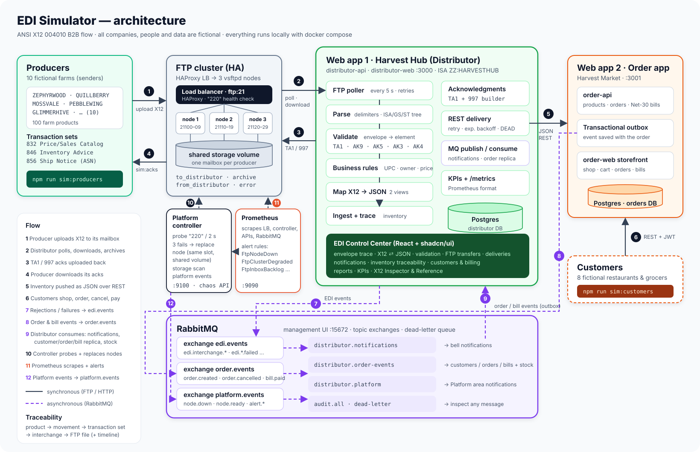
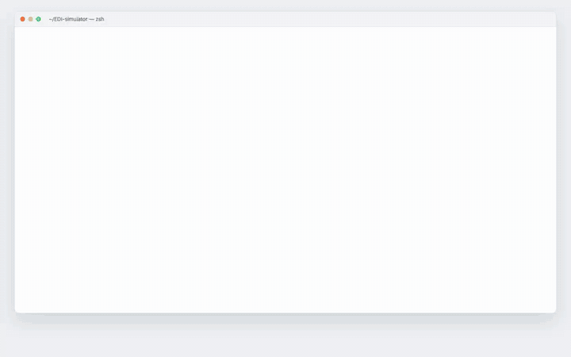
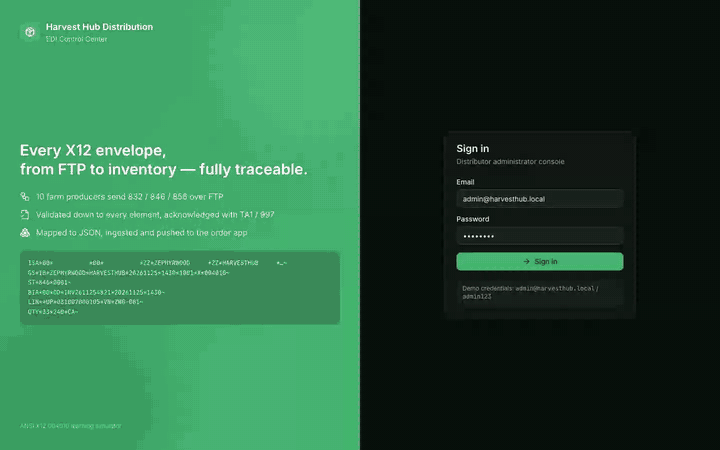

# EDI Simulator — learn ANSI X12 by running a B2B supply chain

A self-contained, Docker-based playground for learning **EDI (ANSI X12 004010)**. Ten farm **producers** send X12 documents over **FTP** to a **distributor**. The distributor validates, acknowledges (TA1 / 997), maps them to JSON, ingests them into its inventory, and pushes them over **REST** to an **order & billing** app where customers buy the products. Every step is traceable back to the original X12 envelope, and **RabbitMQ** carries the notifications and events.

[](docs/architecture.svg)

<sub>Click the diagram to open it full size. Source: [docs/architecture.svg](docs/architecture.svg).</sub>

> All companies, people, addresses, IDs and e-mails in this project are **fictional** (e-mails use the reserved `.example` domain). Any resemblance to real businesses is coincidental.

## Demo videos

Three short recordings of the real stack running locally. The previews play inline; click one (or a ▶ link) to play the full-quality MP4 in your browser. The MP4 files are also in [docs/demo](docs/demo) if you prefer to download them.

| 1 · Infrastructure | 2 · Distributor — EDI Control Center | 3 · Customer — Order app |
|:---:|:---:|:---:|
| [](https://cdn.jsdelivr.net/gh/eduardocerqueira/EDI-simulator@main/docs/demo/infra.mp4)<br/>**[▶ Play full video (2:16)](https://cdn.jsdelivr.net/gh/eduardocerqueira/EDI-simulator@main/docs/demo/infra.mp4)** | [](https://cdn.jsdelivr.net/gh/eduardocerqueira/EDI-simulator@main/docs/demo/distributor.mp4)<br/>**[▶ Play full video (3:42)](https://cdn.jsdelivr.net/gh/eduardocerqueira/EDI-simulator@main/docs/demo/distributor.mp4)** | [](https://cdn.jsdelivr.net/gh/eduardocerqueira/EDI-simulator@main/docs/demo/customer.mp4)<br/>**[▶ Play full video (1:47)](https://cdn.jsdelivr.net/gh/eduardocerqueira/EDI-simulator@main/docs/demo/customer.mp4)** |
| The stack and the **HA FTP cluster** (load balancer + 3 nodes on shared storage), producer mailboxes, `sim:producers` sending good and bad X12 spread across the nodes, the pipeline log, a live **`chaos:ftp`** run (node frozen → replaced → serving again), HAProxy stats, Prometheus graph and alerts, and RabbitMQ exchanges and queues. | Dashboard, envelope trace (ISA → GS → ST), annotated segments, rejections with their X12 codes, X12 ⇄ JSON, FTP drawer, validation, notifications, inventory traceability, KPIs, **Platform → FTP Cluster** (simulated node failure healing on screen) and **Storage**, and the X12 Inspector. | Shopping the EDI-loaded inventory, cart and checkout (Net-30 bill), cancelling an order, paying a bill, and the resulting RabbitMQ events arriving at the distributor. |

<sub>Recorded with Playwright against the running apps: see [scripts/demo](scripts/demo) to re-record them.</sub>

## Quick start

Requirements: Docker (Desktop) with Compose v2. Node 22+ is only needed to run the simulator from your host.

```bash
npm install                     # once, for the simulator / local dev
docker compose up -d --build    # postgres, rabbitmq, ftp, 2 APIs, 2 web apps

# 1) producers: one valid 832 catalog per producer, then 40 mixed transactions (25% bad)
npm run sim:producers -- --bootstrap -n 40 -b 0.25

# 2) customers: browse the EDI-loaded inventory, order, cancel, pay
npm run sim:customers -- -c 5 -o 20
```

No Node on the host? Run the simulator as a container instead:

```bash
docker compose run --rm simulator producers --bootstrap -n 40
docker compose run --rm simulator customers -o 20
```

| What | URL | Login |
|---|---|---|
| **Distributor** (EDI control center) | http://localhost:3000 | `admin@harvesthub.local` / `admin123` |
| **Order app** (customer storefront) | http://localhost:3001 | `nova@copperleaf.example` / `password123` (8 seeded customers, or register) |
| RabbitMQ management | http://localhost:15672 | `edi` / `edi` |
| Distributor API / Prometheus metrics | http://localhost:4000/api/health · /metrics | |
| Order API | http://localhost:4100/api/health | |
| FTP (load balancer → 3 nodes) | `ftp://localhost:21` | `distributor`/`distributor123`, producers e.g. `zephyrwood`/`producer123` |
| HAProxy stats (FTP load balancer) | http://localhost:8404 | |
| Prometheus (metrics + alerts) | http://localhost:9090 | |
| Platform controller API / metrics | http://localhost:9100/api/state · /metrics | |

Reset everything (databases, FTP mailboxes, queues): `docker compose down -v`.

## High-availability FTP platform

The FTP server is a **cluster** rather than a single container, so a producer can always deliver files even when an FTP node hangs or crashes.

| Piece | What it does |
|---|---|
| **Load balancer** (`ftp`, HAProxy) | Keeps the service name and port `ftp:21`, so producers, the distributor and the simulator need no changes. Control connections are balanced across healthy nodes with an FTP-aware health check: a node must answer the `220` greeting. |
| **3 FTP nodes** (`ftp-node-1..3`) | Identical vsftpd nodes ([infra/ftp/Containerfile](infra/ftp/Containerfile)) that all mount **one shared storage volume** (`ftp-storage`) holding every producer mailbox. Each node owns a passive port range (21100–09, 21110–19, 21120–29), and the load balancer routes each range to its node so FTP data connections reach the node holding the session. |
| **Platform controller** ([apps/platform-controller](apps/platform-controller)) | Probes every node's FTP greeting every 2 s. After 3 failed probes it declares the node **DOWN**, removes the container and **spawns a new one** in the same slot: same image, same shared volume, same network alias the load balancer resolves. It measures the recovery time, scans the shared volume (fresh / archived / acks / error files per producer), and publishes `platform.*` events to RabbitMQ. |
| **Prometheus** ([infra/prometheus](infra/prometheus)) | Scrapes HAProxy (per-node status, sessions, traffic), the controller and the APIs, and evaluates alert rules: `FtpNodeDown`, `FtpClusterDegraded`, `FtpClusterUnavailable`, `FtpLoadBalancerBackendDown`, `FtpInboxBacklog`, `FtpStorageAlmostFull` and `PlatformControllerDown`. Firing and resolved alerts become platform notifications. |

**Break a node and watch it heal:**

```bash
npm run chaos:ftp                     # freeze a random node (docker pause: accepts TCP, never answers)
npm run chaos:ftp -- --node 2         # pick the node
npm run chaos:ftp -- --mode kill      # crash it instead
```

The script injects the failure with the Docker CLI, then follows the recovery live. During the outage it keeps listing a producer mailbox through the load balancer to show FTP stays available:

```
+  0s  ftp-node-2   READY     gen 1   LB ok
+  5s  ftp-node-2   SUSPECT   gen 1   LB ok
+ 10s  ftp-node-2   STARTING  gen 2   LB ok
+ 13s  ftp-node-2   READY     gen 2   LB ok
timeline : first failed probe +4s → declared down +10s → new container +10s → serving +13s
```

In the EDI Control Center, **Platform → FTP Cluster** shows the nodes and their status, load-balancer state, traffic and sessions per node, probe latency, Prometheus alerts, the recovery timeline and platform notifications, plus a *Simulate failure* button. **Platform → Storage** shows the shared volume per producer: fresh, archived, acks and error files, bytes on the volume, and inbound/outbound traffic.

> The controller needs the Docker socket (`/var/run/docker.sock`) to replace containers, the role an orchestrator such as Kubernetes would play in production. The shared volume stands in for network storage such as NFS or EFS.

## The scenario

| Role | Who | What they do |
|---|---|---|
| **Producers** (senders) | 10 farms: Zephyrwood Greens, Quillberry Orchards, Mossvale Creamery, … each with an ISA ID such as `ZEPHYRWOOD` | Send X12 over FTP. Together they offer **100 farm products** (10 each) with real UPC-A check digits ([packages/shared/src/catalog.ts](packages/shared/src/catalog.ts)) |
| **Distributor** (receiver) | Harvest Hub Distribution, ISA ID `HARVESTHUB` | Receives, validates, acknowledges, maps, stores, and forwards inventory to the order app. Admins see everything |
| **Customers** | Restaurants and grocers in the order app | Buy what's in stock. Every order creates a **bill due in 30 days (Net 30)** and notifies the distributor |

### Transaction sets

| Set | GS01 | Name | Effect in the distributor |
|---|---|---|---|
| **832** | SC | Price/Sales Catalog | Creates/updates products, unit cost and price (sell price = cost + 35% markup) |
| **846** | IB | Inventory Inquiry/Advice | Sets the quantity available for sale (`QTY*33`) |
| **856** | SH | Ship Notice (ASN) | Hierarchical `HL` Shipment → Order → Item; adds the shipped quantity to stock |
| **997** | FA | Functional Acknowledgment | *Sent back* to the producer: accepted/rejected per group (AK9), per transaction (AK5), per segment (AK3) and per element (AK4) |
| **TA1** | — | Interchange Acknowledgment | *Sent back* when the envelope is rejected or when `ISA14 = 1` |

## What happens to one file

1. **Transfer.** The producer uploads `846_ZEPHYRWOOD_000000123.x12.tmp` and renames it to `.x12`, so the distributor never reads a half-written file. The FTP poller (every 5 s) downloads it, stores its SHA-256, and moves it to `archive/`. Download failures are retried up to 5 times, then the file is moved to `error/`.
2. **Parse.** The delimiters are read from the fixed-length ISA: the element separator is ISA character 4, ISA16 is the component separator, and the next character is the segment terminator. The file is then split into the envelope tree ISA → GS → ST…SE → GE → IEA.
3. **Envelope validation (TA1).** Checks ISA length (106), element values, receiver = `HARVESTHUB`, sender = the mailbox owner, IEA02 = ISA13, IEA01 = group count, and duplicate control numbers.
4. **Group validation (997 AK9).** Checks GS01 is supported, version is `004010`, GE02 = GS06 and GE01 = transaction count.
5. **Transaction validation (997 AK5/AK3/AK4).** Checks SE01 segment count, SE02 = ST02, and segment order, usage and loops against the transaction spec. Element type, length, code list, date and time are checked too, plus guide rules (CTT count, HL parent references).
6. **Business rules.** These run on syntactically valid sets: valid UPC check digit, product exists (send an 832 first), product belongs to this producer, positive price and quantity, ship-to is the distributor. A failure here still gets **997 = Accepted**, because syntax ≠ business, but the transaction is `BUSINESS_REJECTED`.
7. **Map → JSON.** Two views are kept. The *X12 JSON* is a structure-preserving view like the course slide (`transactionSetHeader`, `beginningSegmentFor…`). The *normalized JSON* holds business objects.
8. **Ingest.** Products and quantities are updated, with an inventory movement that links each change to the transaction.
9. **Deliver.** The data goes to the order app as `POST /api/integration/inventory` (idempotent on `transactionId`). Retries use exponential backoff: 2 s, 4 s, 8 s, 16 s, then `DEAD` plus a notification. `DELIVERY_FAILURE_RATE` (default 5%) injects transient failures so you can watch retries. You can also stop the order app with `docker compose stop order-api`.
10. **Acknowledge.** The TA1 and/or 997 interchange is uploaded to `from_distributor/`. Producers can fetch them with `npm run sim:acks`.
11. **Notify.** Events are published to RabbitMQ (`edi.events`). Rejections and failures are routed to `distributor.notifications` and appear in the UI bell.

Every step is written to the **processing timeline**. In the distributor UI, open any envelope, transaction or product and follow the chain *product → inventory movement → transaction set → interchange → FTP file*.

## Simulating

### Producers (X12 over FTP)

```bash
npm run sim:producers -- [options]
  -n, --count 20          transactions to send
  -b, --bad-ratio 0.25    share with injected errors
  -t, --types 832,846,856
  -p, --producers 3       N random producers, or a list: ZEPHYRWOOD,PEBBLEWING
  -i, --interval 300      ms between files
      --bootstrap         first send a valid 832 from each producer (do this on a fresh DB)
  -s, --scenario ID       force one error scenario for every file
      --dry-run           only write files to ./simulator-output/sent
npm run sim:scenarios     # list all bad-data scenarios
npm run sim:acks          # download the TA1/997 the distributor sent back
npm run sim:inspect -- simulator-output/sent/<file>.x12   # explain a file segment by segment
```

Every file is also saved in `simulator-output/sent/`, with a `manifest.jsonl` recording which scenario was injected and the expected acknowledgment.

### Bad-data scenarios

| Layer | Scenarios | Detected as |
|---|---|---|
| Interchange | `ISA_IEA_CONTROL_MISMATCH`, `ISA_BAD_PADDING`, `UNKNOWN_SENDER`, `WRONG_RECEIVER`, `IEA_GROUP_COUNT`, `INVALID_ISA_DATE`, `DUPLICATE_INTERCHANGE`, `MISSING_IEA` | TA1 R (001, 022, 006, 009, 021, 014, 025, 023) |
| Functional group | `GS_GE_CONTROL_MISMATCH`, `GE_TRANSACTION_COUNT`, `UNSUPPORTED_VERSION`, `WRONG_FUNCTIONAL_ID` | 997 AK9 R (4, 5, 2) / AK5 6 |
| Transaction set | `SE_SEGMENT_COUNT`, `ST_SE_CONTROL_MISMATCH`, `MISSING_SE` | 997 AK5 R (4, 3, 2) |
| Segment | `MISSING_BEGINNING_SEGMENT`, `UNKNOWN_SEGMENT`, `MISSING_CTT` | 997 AK3 (3, 1) |
| Element | `INVALID_QUALIFIER`, `INVALID_DATE`, `NON_NUMERIC_QUANTITY`, `MISSING_REQUIRED_ELEMENT`, `ELEMENT_TOO_LONG`, `CTT_COUNT_MISMATCH`, `HL_INVALID_PARENT` | 997 AK4 (7, 8, 6, 1, 5) |
| Business | `UNKNOWN_PRODUCT`, `FOREIGN_PRODUCT`, `NEGATIVE_PRICE`, `NEGATIVE_QUANTITY` | 997 A, then business-rejected |

`npm test` runs every scenario through the validator and asserts the expected code ([apps/simulator/src/scenarios.test.ts](apps/simulator/src/scenarios.test.ts)).

### Customers (REST against the order app)

```bash
npm run sim:customers -- -c 5 -o 20 --cancel-ratio 0.15 --pay-ratio 0.3
```

Each action is written to a **transactional outbox** in the same DB transaction, then published to RabbitMQ `order.events`. The distributor consumes these events to keep a replica of customers, orders and bills, adjust stock, and raise notifications.

## The two web apps

**Distributor — Harvest Hub EDI Control Center** (admin)
- Dashboard with live KPIs, throughput charts, top validation errors, recent envelopes and notifications.
- **EDI**: interchanges with a full trace page (envelope visualization ISA→GS→ST, annotated segments, raw X12, validation issues with TA1/AK codes, processing timeline, acks, REST deliveries), transaction sets (X12 ⇄ X12-JSON ⇄ normalized JSON ⇄ payload sent to the order API, plus a redeliver button), FTP transfers (inbound/outbound, retries), the validation explorer, the delivery queue and acknowledgments.
- Notification center (EDI failures from RabbitMQ, order events).
- Producers (partner scorecards, FTP mailboxes, products) and inventory (stock, cost, price, movement history traced back to X12).
- Customers, orders and bills (Net 30, overdue), plus reports (revenue, AR aging, by category/producer, top customers/products).
- KPIs/observability page, an **X12 Inspector** (paste any X12 to see it explained and validated) and an **X12 reference** (segments, elements, code lists).

**Order app — Harvest Market** (customers): dashboard, shop (inventory synced from EDI, showing source ICN), cart and checkout, orders (cancel), bills (pay), and reports.

## KPIs

| KPI | Definition |
|---|---|
| Acceptance rate | transaction sets ingested ÷ received |
| First-pass yield | interchanges fully accepted ÷ received |
| Processing latency (avg / p95) | file downloaded → interchange processed |
| End-to-end latency | file received → JSON delivered to the order app |
| Ack turnaround | file received → TA1/997 uploaded to the partner |
| Delivery success / first-attempt success / retries / backlog / dead | REST integration health |
| Validation errors by level and code | where the partners' data quality problems are |
| Partner scorecard | acceptance rate, errors and last-seen per producer |
| Inventory | SKUs, units, stock value (cost/retail), low-stock, out-of-stock |
| Orders and billing | orders, revenue, AOV, cancellation rate, open AR, overdue AR |

Prometheus metrics (`edi_files_received_total`, `edi_transactions_total{type,status}`, `edi_validation_errors_total{level,code}`, `edi_processing_duration_seconds`, `edi_delivery_attempts_total`, `edi_acks_sent_total`, `mq_messages_*`) are exposed at `:4000/metrics`.

## Project layout

```
packages/
  x12/        X12 engine: parser, spec-driven validator, writer, 997/TA1 builders, mappers, inspector
  shared/     producers & 100 products, service contracts, RabbitMQ helper (topology)
  ui/         shared shadcn/ui components + theme (Tailwind v4)
apps/
  distributor-api/   Fastify + Prisma: FTP poller, pipeline, REST delivery, MQ consumers, KPIs
  distributor-web/   React admin console
  order-api/         Fastify + Prisma: customers, products, orders, bills, outbox, integration endpoint
  order-web/         React storefront
  simulator/         CLI: producers (X12 over FTP), customers (REST), inspect, acks
  platform-controller/  self-healing for the FTP cluster, storage scan, platform events + metrics
infra/
  ftp/Containerfile  vsftpd FTP node (cluster of 3 on one shared storage volume)
  haproxy/           load balancer for the FTP cluster (control + passive port ranges)
  prometheus/        scrape config + FTP cluster alert rules
  docker/Dockerfile  multi-target image (api / web / simulator)
docs/
  X12-PRIMER.md      how to read an X12 envelope, using this project's files
  architecture.svg   architecture diagram
  demo/              demo videos (MP4) + inline previews (GIF)
scripts/
  e2e.sh             end-to-end acceptance test (CI gate), incl. an FTP node failure
  chaos/             ftp-node-fail.sh — break an FTP node and watch it self-heal
  demo/              Playwright recorder for the demo videos
```

## Local development (hot reload)

```bash
npm install
npm run infra:up                                   # postgres, rabbitmq, FTP cluster, controller, prometheus
cp apps/distributor-api/.env.example apps/distributor-api/.env
cp apps/order-api/.env.example apps/order-api/.env
(cd apps/distributor-api && npx prisma db push) && (cd apps/order-api && npx prisma db push)
npm run dev:distributor-api   # :4000
npm run dev:order-api         # :4100
npm run dev:distributor-web   # :5173 (proxies /api → :4000)
npm run dev:order-web         # :5174 (proxies /api → :4100)
npm test && npm run typecheck
```

## CI — PR acceptance gate

[.github/workflows/pr.yml](.github/workflows/pr.yml) runs on every pull request to `main`:

| Job | What it verifies |
|---|---|
| **Typecheck · unit tests · build** | Prisma schemas are valid, TypeScript in every workspace, X12 engine + all 29 bad-data scenarios (`npm test`), both web apps build |
| **End-to-end** | [scripts/e2e.sh](scripts/e2e.sh) starts the whole Docker stack, sends 10 catalogs + 15 valid files + one file per error layer over FTP, then asserts the exact accepted / rejected counts, the TA1/997 codes, REST deliveries, acks, RabbitMQ notifications, product → X12 traceability, the order app inventory, customer orders with Net-30 bills, and both web apps behind nginx. It also **freezes an FTP node** mid-test and asserts that uploads keep working through the load balancer, the node is replaced and READY again, platform notifications arrive, and Prometheus and the platform overview report the cluster correctly |
| **PR gate** | Passes only when both jobs pass — make it the single *required status check* in the branch protection rule for `main` |

Run the same gate locally: `npm run typecheck && npm test && scripts/e2e.sh` (the e2e uses its own compose project `edi-e2e`, but the same host ports, so stop the dev stack first).

Learning resources: start with [docs/X12-PRIMER.md](docs/X12-PRIMER.md), then open the **X12 Inspector** in the distributor UI and paste one of the files from `simulator-output/sent/`.
